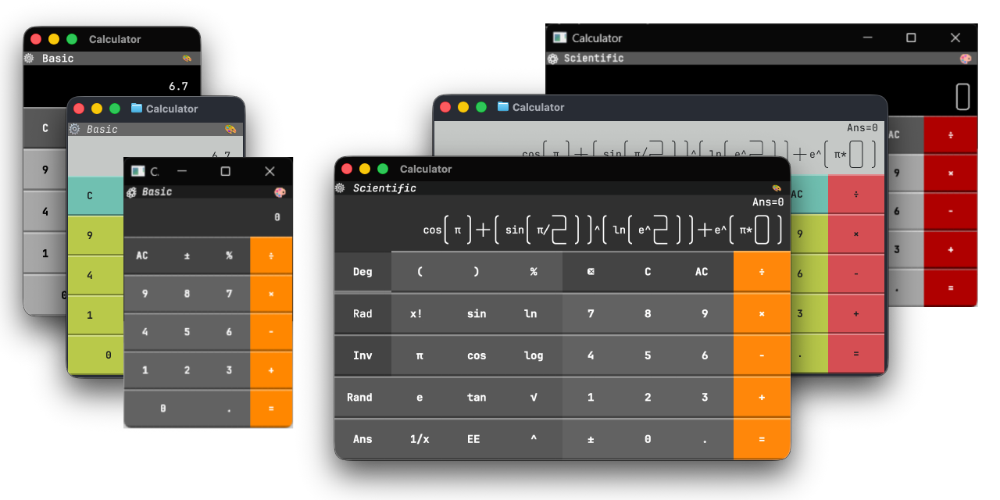
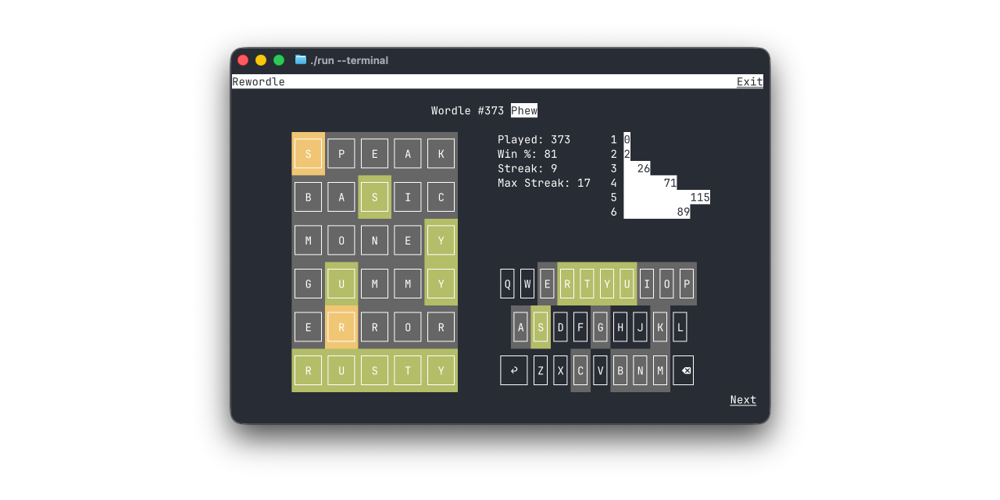
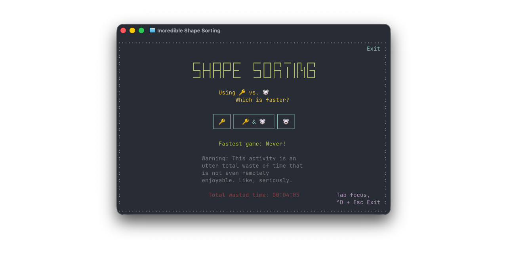
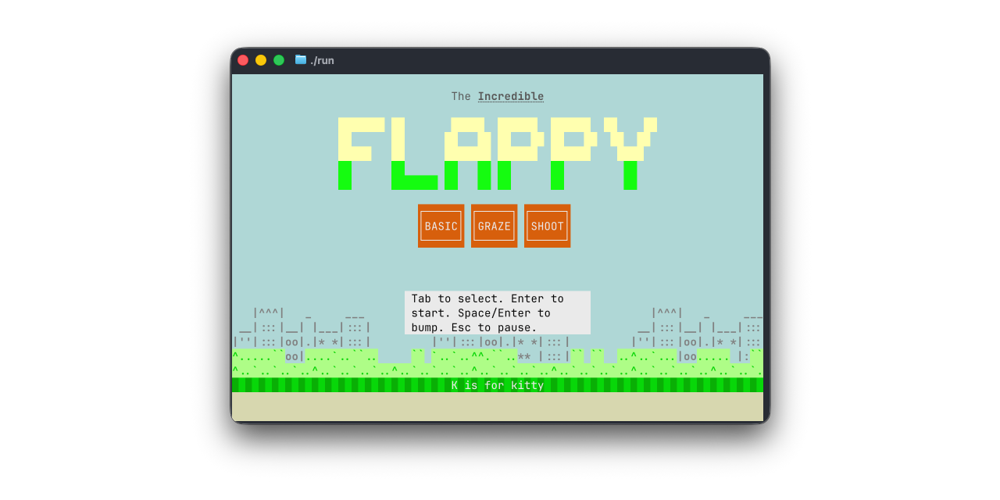
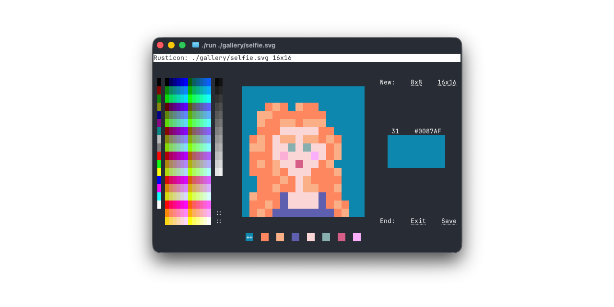

[Home](./wasm.md) > Showcase

# Showcase

Apps made with Incredible.

---

## Incredible Calculator

A TUI calculator that works as a terminal app, macOS app, Windows app and in the browser. Has two modes: a pocket-style **Basic** keypad and a full **Scientific** one.

[Repository](https://github.com/ronilan/incredible-calculator)

---

## Rewordle

Rewordle lets you play all the Wordle words from the beginning.

[Repository](https://github.com/ronilan/rewordle-rust)

---

## Shape Sorting

Shape Sorting is a game, or, ok maybe better, an activity, about sorting shapes by color or shape, played with the keyboard, the mouse, or both.

[Repository](https://github.com/ronilan/shape-sorting)

---

## Incredible Flappy

Flappy Bird for your terminal, with three ways to play: dodge the pipes, graze the flowers, or shoot the invaders.

[Repository](https://github.com/ronilan/incredible-flappy)

---

## Rusticon

Rusticon is a mouse driven SVG favicon editor for your terminal (that also works on the web).

[Repository](https://github.com/ronilan/rusticon)

---

[Home](./wasm.md) > Showcase
